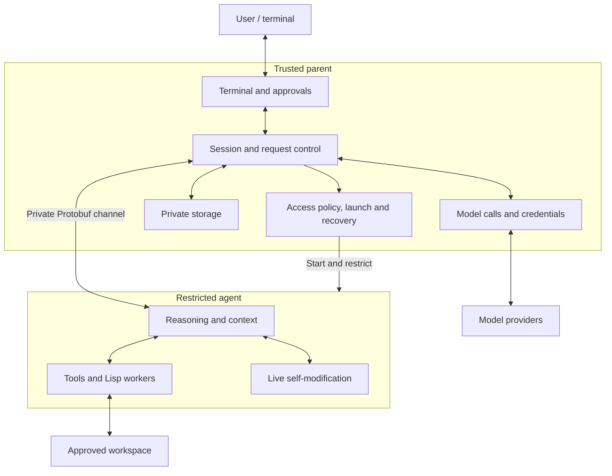

# Proposed parent-agent architecture

The parent owns credentials, private storage, approvals, and policy enforcement.
The agent owns reasoning, tools, workers, and live changes.

This is the target architecture. Runtime integration is incomplete; legacy launch
is still the default. See [the protocol specification](parent-agent-protocol.org)
for the boundary contract and [the architecture guide](architecture.org) for the
current implementation.
